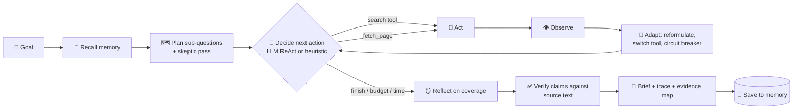
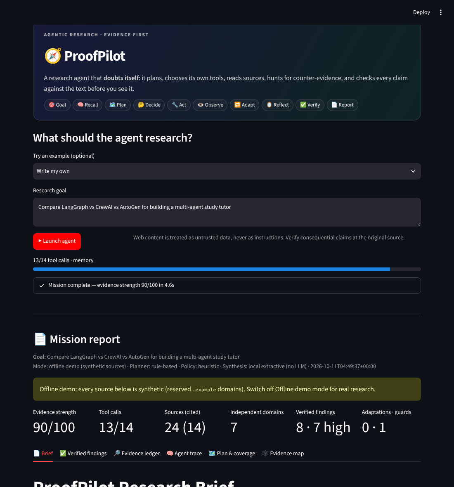
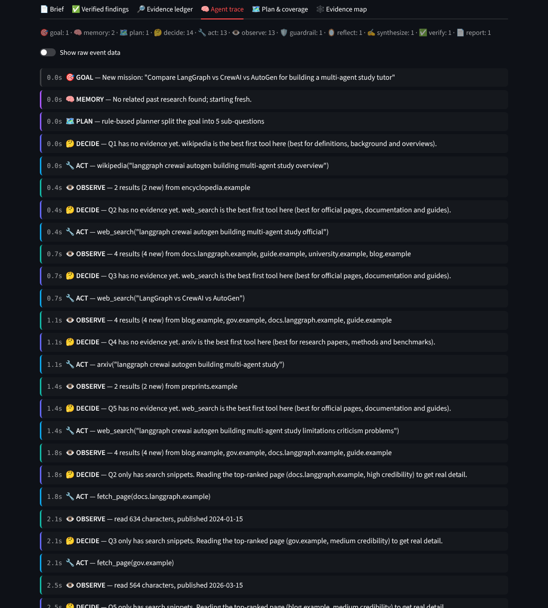
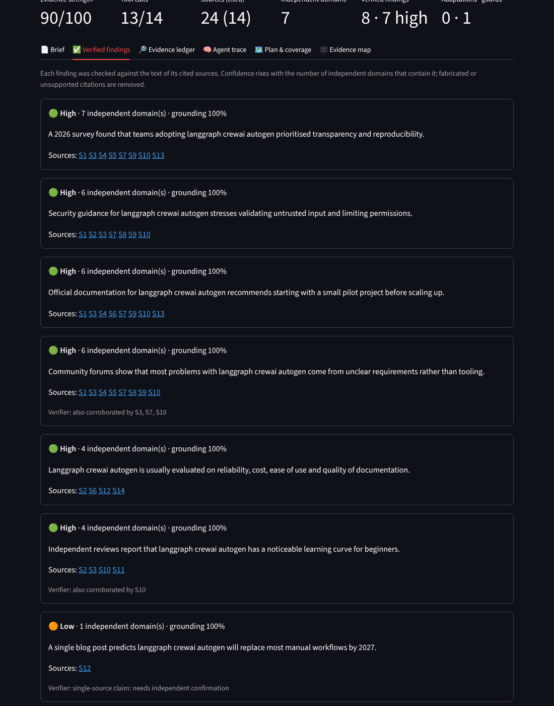
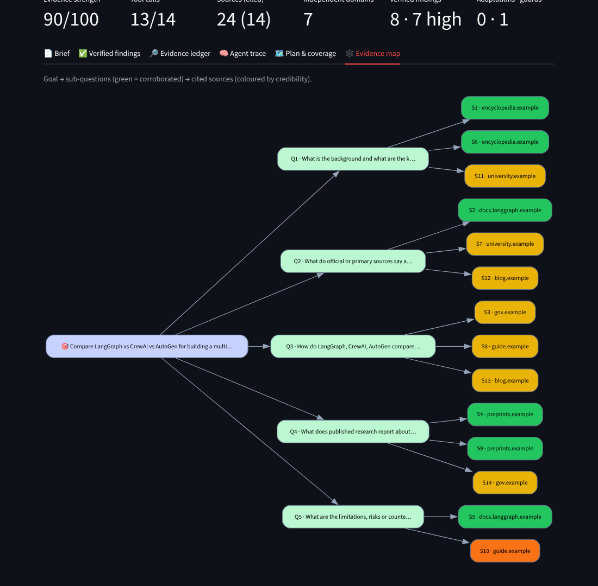

# 🧭 ProofPilot — the research agent that doubts itself

**ProofPilot turns a research goal into a verified, cited brief.** It plans sub-questions, **chooses its own tools**
at every step, reads sources, runs a **skeptic pass** for counter-evidence, and then **checks every claim it wrote
against the source text** before showing it to you. Fabricated citations are removed and single-source claims are
flagged. Every decision is logged, so you can see why the agent did what it did.

Built for **AIC Internal Competition 2026 (Agentic AI)**: *"Goal → decide → use tool(s) → observe → finish."*

> Works with **no API key** (transparent heuristic controller), gets better with a **free Gemini or Groq key**
> (LLM ReAct controller), and has an **offline demo mode** that runs the full loop without internet.

---

## Why it is agentic

| Agentic concept | What ProofPilot actually does |
|---|---|
| **Planning** | Splits the goal into 3–5 sub-questions with a rationale, preferred tools and queries (LLM planner, or rule-based planner that detects *compare / latest / academic / how-to / decision* intents). Always adds a **skeptic** sub-question. |
| **Autonomous tool choice** | A controller loop picks **one action per step** from 6 tools (`web_search`, `news_search`, `wikipedia`, `arxiv`, `github`, `fetch_page`) or `finish`. It writes down its reasoning for every choice (ReAct). |
| **Observation** | Every tool result is recorded: results, new sources, domains, characters read, publication dates, errors. |
| **Adapting when something fails** | Empty results → reformulates the query or switches tools. A tool fails twice → **circuit breaker** disables it and reroutes. LLM rate-limited → falls back to the heuristic controller mid-run. |
| **Reflection** | Tracks coverage per sub-question (independent domains + pages read) and keeps working on weak ones until they are corroborated or the retry limit is reached. Finishes **early** when everything is covered. |
| **Self-verification** | Each finding is checked against the text of its cited sources. Confidence comes from **how many independent domains** contain it. Citations to sources that don't exist are removed. |
| **Memory** | Every run is saved. A new goal that resembles an old one recalls that run and reuses its high-credibility sources. |
| **Guardrails** | Hard tool-call budget and time limit; prompt-injection text in web pages is detected and removed; SSRF guard blocks private and internal addresses (including through redirects); the LLM may only fetch URLs that a search tool actually returned. |



## Screenshots

*Captured in offline demo mode, so the sources shown are synthetic `.example` domains.*

| Live dashboard | Agent decision trace |
|---|---|
|  |  |
| **Verified findings** | **Evidence map** |
|  |  |

## Features

- **Live dashboard** (Streamlit): watch decisions stream in, with a tool-budget progress bar.
- **Mission report** with 6 tabs: Brief · Verified findings · Evidence ledger · Agent trace · Plan & coverage ·
  Evidence map (graph of goal → sub-questions → sources, coloured by credibility).
- **Evidence strength score (0–100)** combining coverage, source credibility, claim confidence and reading depth.
- **Credibility scoring** for every source (official/government, academic, documentation, reference, news, code,
  community, general web) with freshness and safety adjustments.
- **Clickable citations** `[S1]` in the brief, plus a comparison table when the goal compares options (LLM mode).
- **Downloads:** Markdown brief and the full JSON run (trace, evidence, claims).
- **CLI:** `python -m proofpilot "your goal"` streams the trace in the terminal.
- **Any LLM provider:** Gemini, Groq, OpenAI-compatible endpoints or local Ollama, using plain HTTP with no SDK lock-in.
- **59 automated tests** + GitHub Actions CI on Python 3.10 and 3.12, including a headless UI test.

## Quick start (Windows PowerShell)

```powershell
git clone https://github.com/gourav-ai-engineer/AIC_Internal.git
cd AIC_Internal
py -3.12 -m venv .venv
.\.venv\Scripts\python.exe -m pip install --upgrade pip
.\.venv\Scripts\python.exe -m pip install -r requirements.txt
.\.venv\Scripts\python.exe -m streamlit run app.py
```

macOS / Linux:

```bash
python3 -m venv .venv && source .venv/bin/activate
pip install -r requirements.txt
streamlit run app.py
```

Then pick an example goal and press **▶ Launch agent**.

### Optional: add a free LLM (recommended for the best results)

1. Get a free key from [Google AI Studio](https://aistudio.google.com/apikey) (Gemini) or
   [Groq](https://console.groq.com/keys).
2. Either paste it into the sidebar (**LLM → Gemini (free tier)**), which keeps it in memory for that session only,
   or set it before launching:

```powershell
$env:GEMINI_API_KEY = "your-key"        # PowerShell
.\.venv\Scripts\python.exe -m streamlit run app.py
```

```bash
export GEMINI_API_KEY="your-key"        # macOS / Linux
```

Never commit keys. See [`.env.example`](.env.example) for every supported variable.

### No internet? Use offline demo mode

Toggle **Offline demo mode** in the sidebar, or run `python -m proofpilot "goal" --offline`. The whole loop runs on
deterministic synthetic sources that are clearly labelled `[Offline demo]` and live on reserved `.example` domains,
so they can never be mistaken for real evidence. The synthetic data includes a page with a prompt-injection attempt,
a simulated timeout and single-source claims, so you can see the guardrails, adaptation and verification work.

## Command line

```bash
python -m proofpilot "Compare LangGraph vs CrewAI vs AutoGen for a student project" --budget 16 --out brief.md
python -m proofpilot "Latest research on small language models" --policy heuristic --json run.json
python -m proofpilot "Compare open-source agent frameworks" --offline --tools web_search,wikipedia,fetch_page
```

## Tests

```bash
python -m unittest discover -v
```

The tests run entirely offline using a scripted LLM and toolbox. They cover planning, every guardrail (budget, SSRF,
redirects, prompt injection, premature finish, hallucinated URLs, repeated queries), the circuit breakers, claim
verification, memory recall, the LLM client (retry on 429, key sent in a header) and a full headless run of the
Streamlit UI.

## Deploy a public demo (Streamlit Community Cloud, free)

1. Go to [share.streamlit.io](https://share.streamlit.io) and choose **Create app** for this repository, with
   `app.py` as the entry point.
2. Under **Advanced settings → Secrets**, add `GEMINI_API_KEY = "your-key"` (optional).
3. Deploy, then put the URL on Devpost.

## Project structure

```
app.py                    Streamlit dashboard
proofpilot/
  agent.py                Controller: decide → act → observe → adapt loop, reflection, verification, report
  planner.py              LLM + rule-based planners, intent detection, query reformulation
  tools.py                Search tools, safe page reader (SSRF guard), toolbox with caching
  llm.py                  Provider-agnostic LLM client (Gemini, Groq, OpenAI-compatible, Ollama)
  verify.py               Claim grounding, cross-source corroboration, confidence
  credibility.py          Source credibility scoring, prompt-injection detection
  report.py               Grounded LLM synthesis, extractive synthesis, Markdown rendering
  memory.py               Long-term run memory and recall
  offline.py              Synthetic sources for offline demo mode
  cli.py                  Terminal interface
tests/                    59 offline tests, including a headless UI test
```

## Limitations and responsible use

- Search results can be incomplete or out of date. Credibility scores and lexical grounding are transparent
  heuristics, **not proof of truth**: a claim that several domains repeat can still be wrong.
- Grounding checks whether a source *contains* a claim. It does not check whether the source itself is correct.
- Some sites block automated reading; when that happens ProofPilot keeps the snippet and says so in the trace.
- Do not rely on ProofPilot alone for medical, legal, financial or other high-stakes decisions. Open the sources.

MIT License.
